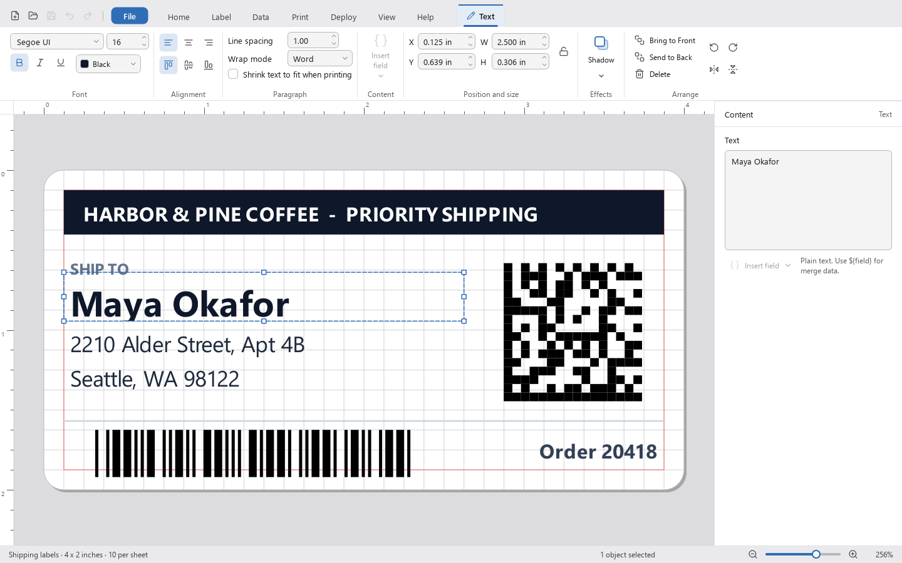
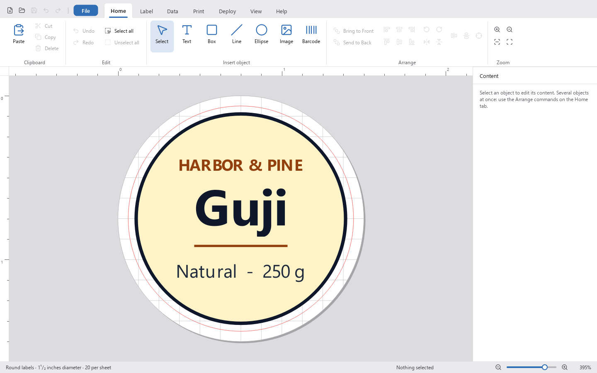
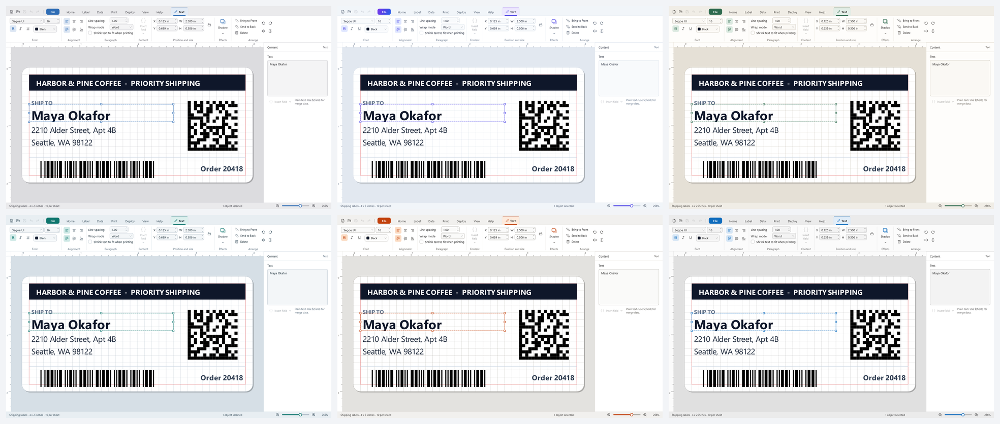
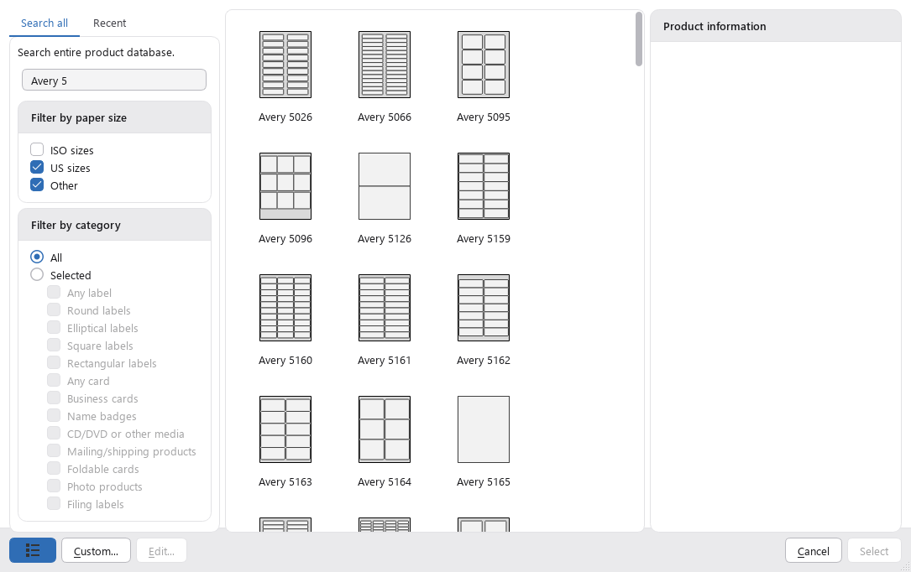
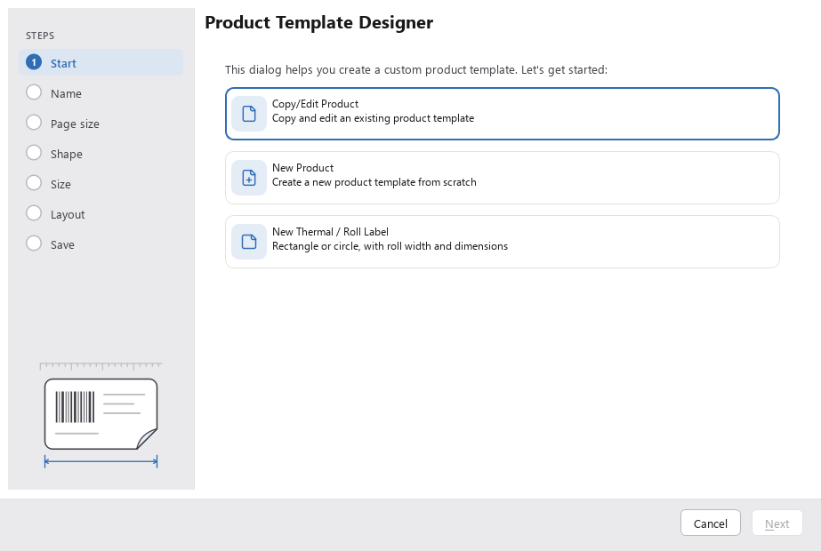
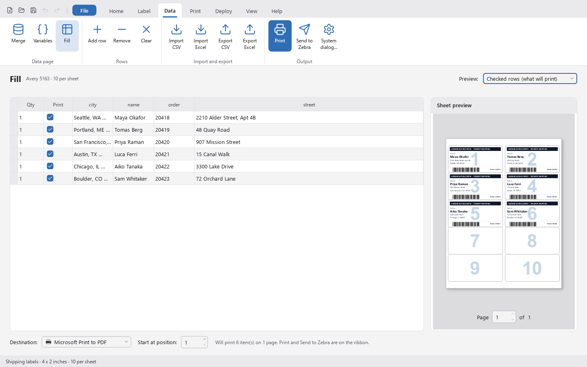

<p align="center">
  <picture>
    <source media="(prefers-color-scheme: dark)" srcset="brand/logo-horizontal-tagline-onDark.svg">
    
  </picture>
</p>

<h3 align="center">A free, open-source label maker for Windows, macOS and Linux.</h3>

<p align="center">
  Design and print address labels, shipping labels, product labels, name badges, business cards and
  barcodes on the sheet or roll you already own. Nearly 1,500 label templates built in. No account, no
  subscription, no cloud.
</p>

<p align="center">
  <a href="https://github.com/SchneiderWasTaken/glabels-neo/releases/latest"></a>
  <a href="https://github.com/SchneiderWasTaken/glabels-neo/actions/workflows/ci.yml"></a>
  <a href="LICENSE"></a>
</p>

<p align="center">
  <picture>
    <source media="(prefers-color-scheme: dark)" srcset="docs/assets/readme/hero-dark.png">
    
  </picture>
</p>

> gLabels Neo is an independent fork. It is **not** the official gLabels project
> and is not endorsed by its author.  All credit for the original application
> goes to [Jaye Evins and the gLabels contributors](CREDITS.md).  If you want
> the upstream project, see [j-evins/glabels-qt](https://github.com/j-evins/glabels-qt).


## Download

Get the latest build for your system from the
**[Releases page](https://github.com/SchneiderWasTaken/glabels-neo/releases/latest)**.

| Platform | Package |
|:---------|:--------|
| Windows (x64) | `glabels-neo-windows-x64.zip` - unzip and run, no install |
| macOS (Apple Silicon) | `glabels-neo-macos-arm64.dmg` |
| Linux (x86_64) | `glabels-neo-linux-x86_64.tar.gz` |

The newest build of `main` is published continuously as the
[edge prerelease](https://github.com/SchneiderWasTaken/glabels-neo/releases/tag/edge).
Updates are strictly opt-in and always pulled by the program, never pushed to it: nothing contacts GitHub
until you agree. The first time you run gLabels Neo it asks whether it may check for new versions (the answer
is *no* unless you say yes) and, separately, whether it may install them without asking. You can change both at
any time in Edit > Preferences > Updates, or look once with Help > Check for Updates. When you agree, it
downloads in the background (in any folder you can write to) and swaps the new version in when you close it,
so the next start is already current. See [Automatic updates](docs/AUTO-UPDATE.md).

> Installers, AppImage/Flatpak, package-manager support (winget, Homebrew, Scoop)
> and automatic release builds on every merge are in progress - see the
> [roadmap](docs/ROADMAP.md).


## A modern, ribbon-style editor

Everything is one click away on the ribbon, grouped the way you work: **Home**, **Label**, **Data**,
**Print**, **Deploy**, **View** and **Help**. Select an object and a matching tool tab appears
(**Text**, **Barcode**, **Image**, **Shape**, **Line**) with its font, colour, size, position and
shadow controls, so there is no side panel to hunt through. The **File** menu opens a full-page
backstage for New, Open, Save and your recent projects.

<p align="center">
  <picture>
    <source media="(prefers-color-scheme: dark)" srcset="docs/assets/readme/round-label-dark.png">
    
  </picture>
</p>

- **Snap and guides.** Drag an object and it snaps to the edges and centres of the other objects, to
  the label's centre, and to the inside of the safe area (never the outer edge). Hold **Alt** to move
  freely; each snap type can be switched off on the **View** tab. See [docs/ribbon-ui/SNAP.md](docs/ribbon-ui/SNAP.md).
- **Round, square, rectangular, elliptical and CD/DVD labels**, with the sheet layout, margins and
  safe area drawn on the canvas, so what you see is what lands on the stick-on label.
- **Barcodes and 2D codes** (Code 39, EAN-13, UPC-A, POSTNET, Data Matrix and more), plain text with
  full font control, images, lines, boxes and ellipses (shadows on everything except barcodes).
- **Six colour themes, each in light and dark**: Graphite (the default), Neo, Paper, Harbor, Signal
  and System. Pick one under **Preferences > Appearance** or on the **View** tab; the change is live.
  See [docs/ribbon-ui/THEMES.md](docs/ribbon-ui/THEMES.md).

<p align="center">
  <picture>
    <source media="(prefers-color-scheme: dark)" srcset="docs/assets/readme/themes-dark.png">
    
  </picture>
  <br>
  <sub>Graphite, Neo, Paper (top row), Harbor, Signal and System (bottom row).</sub>
</p>


## Pick your label stock

Choose from **nearly 1,500 built-in templates** for Avery, Online Labels, Herma, Hisago, Rayfilm,
Brother, Dymo, Zweckform and many other makers, in US Letter, A4 and other sheet sizes. Search by part
number ("5160", "L7160"), by paper size or by shape. If your stock is not listed, the **Product Template
Designer** walks you through a custom sheet or roll label step by step.

<p align="center">
  <picture>
    <source media="(prefers-color-scheme: dark)" srcset="docs/assets/readme/templates-dark.png">
    
  </picture>
  <picture>
    <source media="(prefers-color-scheme: dark)" srcset="docs/assets/readme/designer-dark.png">
    
  </picture>
</p>


## Print a whole run from a spreadsheet

The **Fill** page turns any label with `${FieldName}` placeholders into a batch table: one row per print
job, a quantity, a Print checkbox, and a live preview of the sheet. Import from **CSV or Excel**, or type
the rows in. Use **Variables** for counters and increments, and **Merge** for the classic mail-merge
formats.

<p align="center">
  <picture>
    <source media="(prefers-color-scheme: dark)" srcset="docs/assets/readme/fill-dark.png">
    
  </picture>
</p>

Try it with the sample files in [docs/assets/samples](docs/assets/samples): open
`shipping-label-merge.glabels`, go to **Data > Fill** and import `shipping-orders.csv`.


## What gLabels Neo adds to gLabels

Everything in gLabels is preserved.  Neo adds:

- **A ribbon interface, themes and snapping** - described above.
- **Fill page** (Ctrl+5) - a batch table where each row is one print job with a
  quantity, a Print checkbox and one column per `${FieldName}` in your label,
  with a live sheet preview and CSV/Excel import/export.
- **Deploy tab** - build a standalone, single-file kiosk executable from the
  designer: the label layout is embedded, selected fields are locked, and the
  result runs on any Windows machine with no install.
- **Kiosk mode** (`glabels-fill`) - a stripped-down app with only the Fill
  table, preview and print.  An admin PIN allows reconfiguration.
- **ZPL thermal printing** - a built-in ZPL renderer for Zebra/ZDesigner printers
  that sends raw ZPL over USB or network, bypassing the OS driver.
- **Custom and thermal/roll label templates** via the Template Designer wizard.
- **Per-column locking** - pre-fill locked columns from a data source while
  operators enter only the per-day values.
- **Automatic updates** that never install anything without your say-so.

See [docs/FILL-AND-DEPLOY.md](docs/FILL-AND-DEPLOY.md) for details, and
[docs/CHANGES-FROM-UPSTREAM.md](docs/CHANGES-FROM-UPSTREAM.md) for exactly what
differs from upstream gLabels.


## Building from source

Requirements: a C++20 compiler, CMake, Ninja and **Qt 6.7 or newer** (6.8+
recommended - QXlsx needs `Qt6::GuiPrivate`).  Optional: libzint, libqrencode,
GNU barcode, QXlsx (fetched automatically when not installed).

```bash
git clone https://github.com/SchneiderWasTaken/glabels-neo.git
cd glabels-neo
cmake -B build -G Ninja -DCMAKE_BUILD_TYPE=Release
cmake --build build -j
ctest --test-dir build --output-on-failure
```

Platform guides inherited from upstream:
[Linux](docs/BUILD-INSTRUCTIONS-LINUX.md),
[macOS](docs/BUILD-INSTRUCTIONS-MACOS.md),
[Windows](docs/BUILD-INSTRUCTIONS-WINDOWS.md).
The single-file kiosk (SFX) build is described in
[docs/FILL-AND-DEPLOY.md](docs/FILL-AND-DEPLOY.md).

The pictures in this README are generated, not hand-captured: run the `MarketingShots` test with
`GLABELS_MARKETING_SHOTS=<folder>` set, then `scripts/make-marketing-assets.py <folder>` (see
[docs/assets/README.md](docs/assets/README.md)).


## License

gLabels Neo is free software licensed under the **GNU General Public License,
version 3 or (at your option) any later version**, inherited from gLabels.
You may use, modify and redistribute it provided derivative works remain under
the same license and source is made available.  See [LICENSE](LICENSE).

- Original work (c) Jaye Evins and gLabels contributors - see [CREDITS.md](CREDITS.md).
- Bundled and linked third-party components are listed in
  [THIRD-PARTY-NOTICES.md](THIRD-PARTY-NOTICES.md) (in preparation).
- Product names such as Avery, Dymo, Brother, Herma and Zweckform appear in label
  templates only to describe compatible label stock; no affiliation or endorsement
  is implied.


## Contributing

Pull requests are welcome - see [docs/CONTRIBUTING.md](docs/CONTRIBUTING.md) and
[docs/CODING-STYLE.md](docs/CODING-STYLE.md).  Improvements that are generally
useful to gLabels are also offered upstream where practical.
